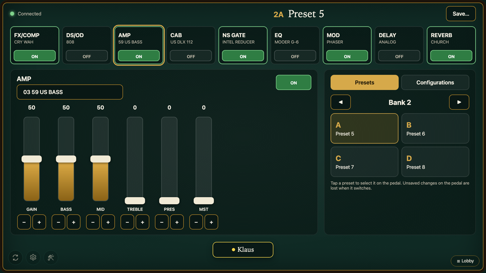
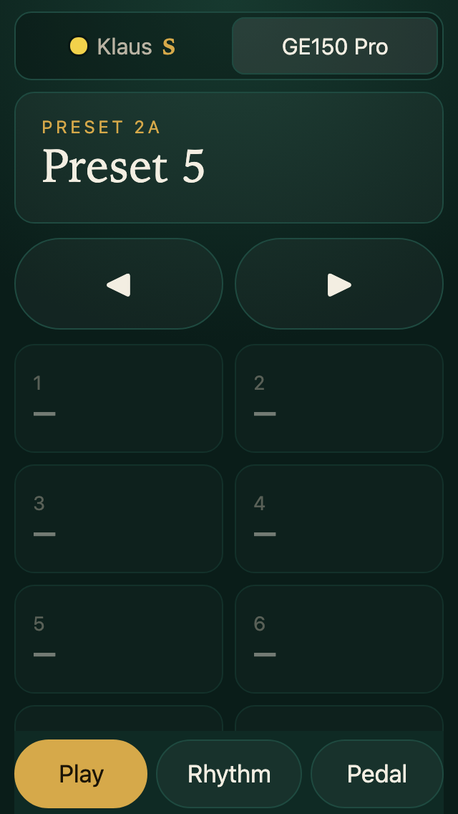

# GE150 Pro for Game Table

[](https://github.com/klaushofrichter/ge150pro-game/actions/workflows/checks.yml)
[](https://github.com/klaushofrichter/ge150pro-game/security/dependabot)

<!-- No release badge: this repository cuts no releases; tables run whatever the production branch holds, and the game's
     calendar version is in games/ge150-pro/manifest.json. -->

Remote control for a **Mooer GE150 Pro** guitar multi-effects pedal as a game for
[Game Table](https://github.com/klaushofrichter/games-service): the pedal is connected to the table's computer by USB,
the board (the table's touchscreen) shapes its sound, and the player's phone recalls sounds and runs a click while they
play. The table only controls the pedal; the guitar plays through the pedal as always. More about Game Table:
**[games.skylar.technology](https://games.skylar.technology)**.

> Unofficial project, not affiliated with or endorsed by Mooer. "Mooer" and "GE150" are trademarks of their owners.





- **One player, at the table.** Choose **GE150 Pro** in the lobby, join with the QR code, mark ready, start.
- **The board** connects to the pedal (or tap **Connect pedal**), loads its 200 presets and shows the signal chain:
  switch modules, choose models from a grid, move each parameter on a large fader, select presets by bank and A–D,
  and **Save…** a sound to its preset slot (it asks first).
- **Configurations**: **Save configuration…** on the board keeps chosen modules exactly as they are, for a **quick
  slot** on the phone (1–8) or for a **footswitch**: when the pedal's footswitch selects that preset, the board applies
  the configuration right after. The pedal's footswitch functions themselves are fixed in its firmware; this adds to
  them without changing the pedal.
- **The phone** has its own tabs: **Play** (current preset, ◀ ▶, quick slots, the expression pedal's target),
  **Rhythm** (the pedal's drum machine by name and tempo, and a **table click** with tap tempo that can follow the
  drum machine) and **Pedal** (connection, configurations: rename, delete; **Finish**). The phone keeps the player's
  configurations between games.
- **Rhythm** on the pedal itself is started and stopped on the pedal: its firmware takes no rhythm commands over USB
  (nor MIDI start/stop or clock). The table click is the table's own, from its speakers.

Rules for players: [`games/ge150-pro/how-to-play.md`](games/ge150-pro/how-to-play.md). Decisions:
[`docs/decisions.md`](docs/decisions.md).

## Table setup

The pedal must be connected to the **table's computer** by USB (the board's browser drives it over WebHID). Only one
program can use the pedal at a time: close Mooer's own editor on that computer.

- **Firmware:** the game supports GE150 Pro firmware **V2.1.2 and newer**. The version number cannot be read over the
  pedal's editor connection, so the board checks the pedal's answers at connect against those of the supported
  firmware; a pedal that answers differently is shown as not supported and nothing is written to it
  ([E-013](docs/decisions.md)). Update older pedals with Mooer's editor.
- **Without a pedal** the game still starts: the board says how to connect it and connects by itself when the pedal is
  plugged in (also after it was unplugged during a game); the phone's table click works meanwhile.

- **Linux tables (Debian 13):** the kiosk runs Google Chrome as the user `table` in a login session (games-service
  `deploy/table-pc`). Chrome needs permission to open the pedal's HID device. Once, as root:

  ```sh
  echo 'SUBSYSTEM=="hidraw", ATTRS{idVendor}=="0483", ATTRS{idProduct}=="5703", MODE="0660", TAG+="uaccess"' \
    > /etc/udev/rules.d/70-ge150pro.rules
  udevadm control --reload && udevadm trigger
  ```

  `uaccess` gives the logged-in kiosk user (`table`, a login session through `PAMName=login`) access. Unplug and plug
  the pedal afterwards.
- **No prompt (optional):** the kiosk runs Chrome in incognito mode, so it forgets which USB devices the board may
  use, and **Connect pedal** opens the device chooser each session. A Chrome policy allows the pedal for the board
  for good (the table host's port, 8080 by default):

  ```json
  { "WebHidAllowDevicesForUrls": [{ "devices": [{ "vendor_id": 1155, "product_id": 22275 }], "urls": ["http://127.0.0.1:8080"] }] }
  ```

  in `/etc/opt/chrome/policies/managed/ge150pro.json` (Google Chrome, which tables run) or
  `/etc/chromium/policies/managed/` (Chromium).
- **Windows and macOS tables:** Chrome and Edge support WebHID without extra setup; the policy above applies the same
  way.

A remote player's board shows what happens but never controls the pedal. The board is made for a 1920 × 1080
multitouch screen (tables use an HP E24t G5): faders follow each finger on its own, so two can move at once.

## How it works

The pedal speaks a small framed protocol over a 64-byte HID interface (vendor `0x0483`, product `0x5703`). This
repository carries the protocol library (`src/ge150/`: framing and CRC, presets, modules, system, expression pedal,
rhythm, the model catalog, the WebHID device), bundled into `games/ge150-pro/assets/ge150.js`.
[`docs/protocol.md`](docs/protocol.md) describes the protocol as the game uses it. The research behind it is in the
GE150PRO repository (`klaushofrichter/GE150PRO`, private).

| Path | Contents |
| --- | --- |
| `games/ge150-pro/` | the game: `manifest.json`, `rules.ts`, `board.js`, `deck.js`, styles, `how-to-play.md`, `assets/` |
| `src/ge150/` | the protocol library (TypeScript), bundled by `scripts/build-assets.mjs` |
| `tests/` | rules on games-service's runtime, the library, the bundle as a table installs it |
| `scripts/e2e/` | browser check on a real Table Host with a simulated pedal (`fake_pedal.js`) |

## Development

```sh
npm ci && scripts/games-service.sh     # Node 26; games-service checkout in .games-service
npm test && npm run typecheck
npm run build:assets                   # after changing src/ge150/; commit games/ge150-pro/assets/ge150.js
python3 -m venv .venv && .venv/bin/pip install -r scripts/e2e/requirements.txt && .venv/bin/python -m playwright install chromium
PATH=$PWD/.venv/bin:$PATH E2E_BROWSER=chrome scripts/e2e/run-all.sh e2e-out   # in Google Chrome, as tables
```

Branching: feature branch → PR into `main` → release PR `main` → `production`; tables install the game from
`production`. Guidance for agents: [`CLAUDE.md`](CLAUDE.md).

## License

[MIT](LICENSE)
