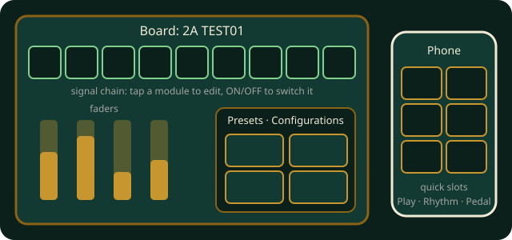

# GE150 Pro

Control a Mooer GE150 Pro guitar multi-effects pedal that is connected to the table by USB. The table only controls
the pedal: your guitar plays through the pedal as always.

## In short

- One player, with the GE150 Pro connected to the table by USB.
- The **board** shapes the sound: modules, models, parameters, presets.
- **Save configuration…** puts a sound on a phone **quick slot** or a footswitch.
- The **phone** recalls quick slots, runs a click and shows the drum machine.
- **Finish** on the phone ends the session.

## Connecting the pedal

Connect the GE150 Pro to the table's computer with a USB cable before starting. The board connects to it by itself
when it can; otherwise tap **Connect pedal** on the board and choose **GE150Pro**. Only one program can use the pedal at
a time: close Mooer's own editor first. The pedal's presets load in a few seconds.

Without a pedal the board says how to connect it, and connects by itself as soon as the pedal is plugged in (also when
it was unplugged during the game). The game needs the pedal's firmware **V2.1.2 or newer**; with an older firmware the
board says so and changes nothing on the pedal: update it with Mooer's editor.

## The board

- **The signal chain** across the top shows the nine modules in the pedal's order. **ON/OFF** switches a module; tap
  its name to edit it below.
- **The editor** shows the module's model (tap it to choose another) and a fader for each parameter: drag anywhere on
  a fader, or use **−** and **+**.
- **Presets** selects a preset by bank and A–D, like the footswitches. Changes are live on the pedal and are lost when
  it switches presets, as on the pedal itself. **Save…** stores the current sound in its preset slot (it asks first).
- **Configurations** lists your saved configurations; **Apply** sets one now.

## Configurations and quick slots

A configuration is a set of modules exactly as they are now, saved from the board with **Save configuration…**. Choose
the modules it sets (the ones you changed are marked), whether it first selects the current preset, and where it goes:

- a **quick slot** (1 to 8) on your phone's **Play** tab: tap the slot while you play;
- a **footswitch**: when you select this preset with the pedal's footswitch, the configuration is applied right after.

Your phone keeps your configurations between games, and you can rename or delete them on its **Pedal** tab.

## Rhythm

The phone's **Rhythm** tab shows the pedal's drum machine: style, tempo, volume and a light at its tempo. Start, stop
and TAP stay on the pedal, which takes no rhythm commands over USB.

The **table click** is a click track from the table's speakers: **Start** and **Stop**, **−** and **+**, **Tap** a few
times for a tempo, **Follow pedal tempo** to use the drum machine's tempo, and the beats per bar (the first is
accented). The board's **Click volume** setting sets its loudness.

## Good to know

- The game never sends a factory reset or a firmware update to the pedal.
- A remote player's board shows what happens but cannot control the pedal; it stays at the table.
